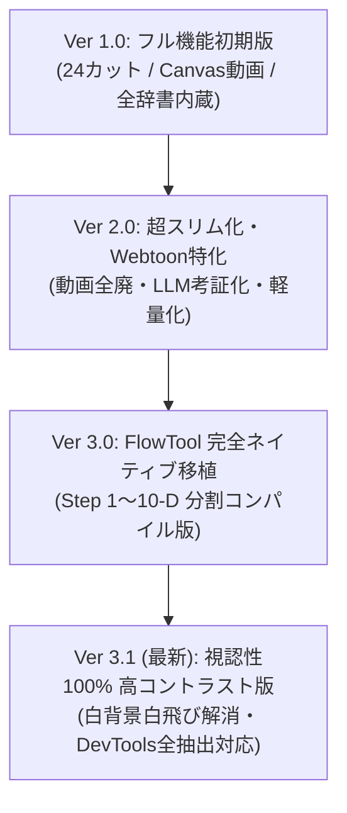

# FlowTool Studio Pro バージョン履歴 & ロールバックガイド

本ドキュメントは、これまでの開発バージョンの履歴、各マイルストーンの特徴、および「過去のバージョンに戻したい」「トラブル時に復元したい」場合の手順書です。

---

## 1. バージョン変遷マイルストーン



| バージョン | 時期 | 主な特徴 | 状態・保管場所 |
| :--- | :--- | :--- | :--- |
| **Ver 1.0 (初期フル機能版)** | 2026年9月〜10月 | 24カット固定、`mediabunny` によるブラウザ内動画生成、大量の時代考証辞書、ZIP出力。重厚だが多機能。 | Git履歴、`config/legacy_source/` |
| **Ver 2.0 (スリム化版)** | 2026年11月上旬 | 動画生成を全廃、辞書をLLMプロンプトに丸投げ、コードを極限まで軽量化し Flow Tool の単一ファイル制限に適応。 | Git コミット `7523516`〜`cdbe2ed` |
| **Ver 2.5 (初成果物出力)** | 2026年11月5日 | 初めてずんだもん主役で自動生成・ZIPパッケージ化に成功した記念バージョン。 | `backups/zip_archives/20261105_063453_001_泰平の朱に染まる影.zip` |
| **Ver 3.0 (FlowTool 移植版)** | 2026年11月6日 | Step 1〜Step 10-D を経て、Flow Tool Webエディタ内に 20 ファイルを完全配置。自律エピソード生成が稼働。 | `backups/web_exports/20261107_FlowTool_WebProject_Code.txt` |
| **Ver 3.1 (最新・視認性修正版)** | 現在 | 白背景で白飛びしていたタイトルやカード文字を濃いダークスレート（`#0f172a`）に高コントラスト化。DevTools一括抽出呪文を完備。 | `src/components/EpisodeSection.tsx`、`backups/` |

---

## 2. 旧バージョン・過去環境へのロールバック（復元）手順

### パターン A: Flow Tool（Web側）のコードを壊してしまい、元に戻したい場合
1. `backups/web_exports/20261107_FlowTool_WebProject_Code.txt` を開きます。
2. 戻したいファイル（例: `App.tsx` や `EpisodeSection` など）のセクションを探してコピーします。
3. Flow Tool の「コード」タブで対象ファイルを開き、貼り付けて保存（またはチャットに「○○のコードをこれで上書きして」と送信）します。

### パターン B: 最新のローカル修正を外部バンドルとして即座にマウントしたい場合
1. `MOUNT_COMMAND.js`（または `scripts/mount/LATEST_MOUNT_COMMAND.js`）を開きます。
2. コードをコピーします：
   ```javascript
   import('https://esm.sh/gh/kymMyLab/flowtoolhuck@a15b1de57d/dist/bundle.js?raw').then(m => { const root = document.getElementById('root') || document.body; root.innerHTML = ''; m.mount(root); console.log('🚀 STUDIO PRO 完全最新版マウント完了！'); });
   ```
3. Flow Tool 画面の DevTools Console（コンテキスト: `top`）に貼り付けて実行します。

### パターン C: Git から特定の過去コミットを復元したい場合
```powershell
# 過去のコミット履歴を確認
git log --oneline -n 20

# 特定のコミット時点のコードを確認・復元（例: 2026/11/5 時点）
git checkout 7523516 -- src/
```

---

## 3. マウント用コミットハッシュ早見表

| コミットハッシュ | デプロイ日時 | 主な更新内容 |
| :--- | :--- | :--- |
| `a15b1de` / `99c8827` | 2026/11/06 21:35 | 最新バンドル（視認性改善・完全パイプライン統合） |
| `8634bf5` | 2026/11/06 06:57 | 微小モーション指示・プリセットチップ強化 |
| `3218bac` | 2026/11/06 05:40 | 四肢の崩れ防止・安定微小アニメーション強制版 |
| `0c24f1a` | 2026/11/06 04:20 | ハードコード排除・歌詞感情同期版 |
| `7523516` | 2026/11/05 06:30 | 初回2カット安定生成・ZIP保存成功版 |

